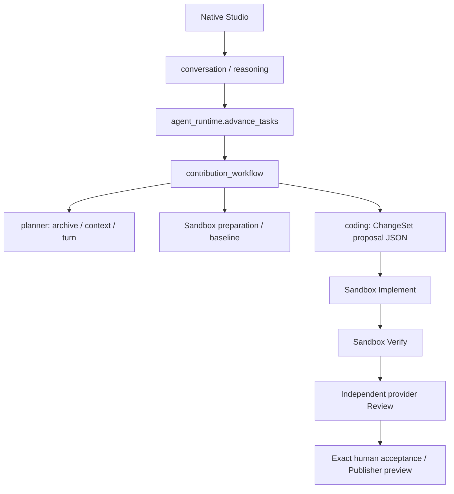

# Agent Runtime v2 acceptance

Specification: [approved refactor specification](../../agent-runtime-v2-refactor-spec.md).
Development branch: `refactor/agent-runtime-v2`; baseline `27802bb5f1e61c3a21c61bc2dfb2ad597ab233d0`.

Evidence is classified separately as deterministic contract, real sandbox,
real model, native journey, human acceptance and external publication.
A passing job or scripted model response is never a completed native journey.
Existing P5-G06, ENV-G01 and UXR-G01 remain open.

## Baseline and root causes

Baseline call chain before this branch:



| Cause | Current source evidence | Executable baseline |
| --- | --- | --- |
| RC-01 | `agent_runtime.advance_tasks` delegates conversation/workflow; no coding tool loop | v1 runtime regression suite |
| RC-02 | `coding.CHANGE_SET_PROPOSAL_SCHEMA`, unique paths in `ImplementationChangeSet` | `test_proposal_validation.py`: duplicate approved path rejected |
| RC-03 | continuation/recovery across conversation, proposal and environment modules | runtime, scheduling and recovery suites |
| RC-04 | planner accepts both read lists then clears both at `context_read_tool_conflict` | `test_context_compaction.py` mixed-read replay |
| RC-05 | package-specific fixed capability plus actual workspace preparation | project-environment / node / workspace suites |
| RC-06 | historical help-only Bun zero exit; current derived classifier already rejects it | verification execution / Bun dispatch suites |
| RC-07 | scripted fixtures prove contracts, not model independence | historical native journey success count remains zero |

A2UI, oh-my-pi and Bun are symptom sources, never repository-name dispatch rules.
The baseline tests assert the old rejection behavior; v2 regressions must replace
that behavior only at the relevant protocol boundary, retaining v1 history.

## Available environment

The current host is macOS arm64 with OrbStack. Initial read-only Docker inspection found
Linux aarch64, no running containers and no locally installed images. This is
not native Linux amd64 evidence. Credentials are never copied from historical
acceptance artifacts or Codex authentication into this product.

Python and TypeScript support is conditional on frozen manifests, approved argv
and working directories, prepared dependencies and a demonstrably executable
baseline. npm/Yarn/pnpm/Bun recognition alone is not verification support.
Unknown native services, browsers or privilege requirements remain blockers.

## Live sample rules

Freeze S1 Python, S2 TypeScript (including a real regression repair) and S3
obsolete/unsupported before starting native journeys. Record repository/base,
issue/goal, model identities, budgets, clock range, all tool receipts, actual
tests, independent review, exact human acceptance and intervention count.
A platform repair ends the current sample as failed; use a new frozen sample.
No sample is yet claimed as a passed autonomous delivery.


## Measured checkpoint (2026-10-28)

Experimental, opt-in and **not accepted for production**. M0–M4 are implemented
and verified at their stated component gates. M5 is incomplete; M6 has local
verification but retains native-delivery and Linux platform gates.

| Verification | Passed | Failed | Skipped | Scope |
| --- | ---: | ---: | ---: | --- |
| Final default regression, four disjoint shards | 1486 | 0 | 53 | No real model; [machine report](regression-results.json) |
| Expanded actual OCI regressions | 36 | 0 | 0 | Environment, source, recovery, six malicious cases included |
| Actual Provider container boundary | 3 | 0 | 0 | Read-only source, gateway-only network, injection |
| Source-tool suite | 7 | 0 | 0 | Five actual Docker cases and two pure authority/UTF-8 cases |
| Native Chromium drawer | 2 | 0 | 0 | Desktop/mobile, XSS, four artifact pages; intercepted contract data |
| Legacy conversation browser | pass | 0 | 0 | Bindings, reload/retry, foreground facts, confirmation preserved |
| macOS arm64/OrbStack doctor | 11 | 0 | 0 | Native Linux amd64 unavailable |

There are **44 unique actual OCI cases**, not 46: the two pure tool tests do
not execute Docker. Repeated or overlapping suites are not added again.
The [tool observer](sandbox_tool_probe.py) records **28 actual receipts**,
including eight check calls: four pass, two genuine assertion failures and two
help-only/zero-test environment blocks. Python and TypeScript are read, searched,
patched twice, tested and diffed from actual files. A failing real baseline
prevents a coding session. The observer supplies scripted tool inputs and makes
no model call; it is component evidence, never autonomous native delivery.
See [sandbox results](sandbox-results.json) and [receipts](macos-tool-receipts.json).

Compilation, runtime integrity, native JavaScript syntax and whitespace checks
pass. The initial midnight-sensitive scan test failed, then passed after its
fixture was pinned to local noon; business scan behavior is unchanged.
Yarn 4 actual preparation initially failed two cases. Repair restores original
bytes only when parsed dependency semantics and original source hashes match;
both original cases and the expanded 36-case suite pass. Original failures and
incomplete first repair remain recorded in the machine report.

## Real model evidence and intervention accounting

All successful coding/Review invocations below use MiniMax M3.1 Flash through
the separate credential gateway. Reviewer is a fresh independent invocation.
No claim of two distinct successful model families is made.

| Frozen controlled sample | Outcome | Coding model calls / tools | Intervention during successful run | Business patches | M5 |
| --- | --- | --- | ---: | ---: | --- |
| Python count-v4 | Real checks and independent Review pass | 4 / 5 | 0 | 0 | No: fixture-planned |
| TypeScript quota-v6 | Real failing test → code repair → passing checks → Review block → retained-workspace attempt → reverify → Review pass | 12 / 10 | 0 | 0 | No: fixture-planned |

TypeScript cumulative usage: 60,311 input / 5,181 output tokens; three reads,
two writes, five checks, two code repairs and one provider retry. The repair
attempt retained workspace, usage and deadline. Review block did not become
pass by default. [Exact journal evidence](controlled-success-06-typescript/journal-evidence.json)
binds diff `3bbfae6bfc873014ea519adcd0aa8d043902ce0e4be57ba1ee425d666dbb8371`,
tests `624fe6bef4f4c6a567c3a1a1d397e4815083222e2e5b14c92147d4edd07654b1`
and final review `84e7dca844c40700a88c4d792756727b0a8acacccb20a631d919f7619248e194`.
[Controlled results](controlled-model-results.json) retain both successes and
all five unsuccessful/ended controlled samples. They are not a native success rate.

| Failed/ended sample | Actual failure | Subsequent maintenance after ending |
| --- | --- | --- |
| Controlled tags-v1 | Vendor call ID reused across turns | Namespace by immutable model Job ID |
| Controlled labels-v2 | Repeated source reads, inadequate current context | Rebuild receipt/workspace/check index |
| Controlled names-v3 | Four bounded model calls, schema/provider errors, zero tools | No business patch |
| Controlled TypeScript count-v4 | Actual independent Review provider failure | Preserve safe typed provider failure |
| Controlled TypeScript limit-v5 | Derived next step kept requesting source reads | Advance next step after successful source receipt |
| Native #1336 | HTTP429 in investigation | Ended; no implementation |
| Native #1332 | Malformed Facade read arguments | Compact typed schemas/empty read-only presentation normalization |
| Native #1268 | Hosted conditional schema HTTP400 | Equivalent disjoint schema, actually probed HTTP200 |
| Native #1339 | Anonymous archive API rate limit | Existing declared read-only credential configured before a new sample |
| Native #1315 | Mixed reads resolved, then large context and empty planning outcome | Hash-bound source search/line pages and nonempty output schema |
| Native radashi #386 | 35 environment prerequisite paths exceed one 32-path read | Persist bounded batches under original budget; sample remains failed |
| Native gradio #13974 | Gateway HTTP502 during planning | No code repair or environment-success claim |
| New radashi #257 entry | Empty final reply and omitted reads after bounded corrections | No invented answer or dispatch; later research explicitly marked operator-assisted |
| New gradio #13906 entry | Future-tense reply without investigation dispatch | Later native planning action explicitly marked operator-assisted |

Every business patch count above is **0**. The five failed controlled samples
record four subsequent platform repair episodes; the successful runs record zero.
Platform changes occurred only after
the affected sample ended and were followed by a new frozen sample. Failed raw
reports are not rewritten; subsequent maintenance is counted in diagnoses.
Actual provider differential probes retain rejected `allOf/if`, rejected
`minProperties`, supported equivalent schemas and the old schema's empty-object
response. No retry/token budget was increased to hide these failures.
Configured old model IDs return HTTP410. The working alternate still sometimes
returns HTTP429; a capability probe alone never establishes delivery reliability.

Actual `os._exit(23)` after a committed result verifies restart without repeating
that tool. Unknown in-flight execution blocks rather than guessing. This is a
real process crash with a deterministic tool backend, **not** evidence of a
killed real-model/container native journey.

## Native acceptance and remaining gates

**Completed and human-accepted native S1/S2 deliveries: 0. Accepted S3: 0.**
The current S1 is more-itertools #1316, frozen before its first native message.
Actual GitHub archive, real sandbox source reads and real model query/line-page
requests produced a saved plan. The product verified base
`4aeb4338ae1407d8da9723e86da99efeb446f719`. Final planning prompt 68,521 bytes
is below the 96 KB hard cap; the 48 KB target is truthfully marked unmet after
explicit source pages are retained. Full originals remain hash-bound artifacts.

[Open S1 in the isolated product](http://127.0.0.1:18080/#/tasks/6727af39-e005-4551-a1ad-93ecf1ad1015).
Plan `2e9e946b-b92c-42ba-be9f-642964e1fae3`, hash
`9049db490a7071a4754f5994de8830705a56b06c81672aa183e945dddd06300c`.
Only `more_itertools/more.py` and `tests/test_more.py` may be written. Five exact
checks are recorded in [native plan evidence](native-research-plan.json).
Preflight is admitted; **actual dependency preparation and baseline have not run**.
Exact human execution approval and later final acceptance are pending.
A general “continue” never substitutes for either approval.

S2 radashi #257 and S3 gradio #13906 research uses real archived source after
the facade entry failed or only narrated future work. The existing product
planning control was invoked once per sample. Each has a durable
`agent_maintenance_recorded` event and is permanently excluded from autonomous
completion, even if subsequent research succeeds. Their manifests and research
reports preserve this distinction. Both newest research jobs ended with `model_gateway_upstream_failure` / Gateway
HTTP502, with no saved plan, execution authorization, edits, tests or Review.
No native boundary success is inferred from an unsupported-looking repository.
All native jobs are terminal; the only saved current S1 plan awaits exact human
approval. No remote write is authorized.

Remaining prerequisites and reproduction:

- A healthy supported model service must complete full-size native requests.
  The final three real native research jobs returned Gateway HTTP502; old model
  IDs returned HTTP410, and empty/invalid responses were bounded and retained.
  Do not raise/reset budgets or replace these failures with a tiny probe pass.
- Human reviews/approves the exact frozen plan in the isolated product, or
  explicitly authorizes that plan/hash/base/scope/checks/model/budget. Only then
  may the product prepare baseline and run implementation. After real checks and
  independent Review, human final acceptance remains a separate gate.
- Complete two unfamiliar supported native tasks, including a real TypeScript
  failing test/repair, and a typed unsupported/upstream-fixed boundary stop.
  If a platform bug occurs, end and fail that sample before modifying platform
  code, then freeze a new sample.
- Supply an actual native Linux amd64/Docker Engine environment. Run the same
  image policy, doctor, malicious, tools and recovery suites there. OrbStack's
  Linux aarch64 guest/emulation does not satisfy this requirement.
- Native exact Publisher preview remains part of the journey. Test account and
  remote publication permissions, if needed, are separate prerequisites. No
  Fork/Push/PR/CLA/ready/comment action is approved by this refactor request.

## Security, compatibility and deployment

Default feature flag remains off. Old v1 execution authorizations and planning
requests retain their original engine/policy. New requests pin their version;
no approval or historical event is rewritten. Additive migration 0038 and real
v0037 backup/upgrade/restore tests preserve hashes and enforce CAS invariants.
See [migration/recovery](../../agent-runtime-v2-migration.md).

Only new storage and loopback **18080** (API), **18081** (credential gateway),
**18765** (browser fixture) are used. Existing user service **8765** and formal
instances are untouched. [Deployment receipt](isolated-deployment.json) records
current health, online-backup/event equality and SQLite integrity/FKs. Publisher
is disabled. API/Orchestrator alone use the existing configuration's explicitly
declared public-read-only GitHub credential; fine-grained permissions are not
claimed to be proven by absent OAuth headers. Provider and Sandbox get no
GitHub token. The gateway alone holds the model key; Sandbox receives neither.

Exact credential absence scans cover changed code/evidence, business database,
artifacts and task logs. Private vault/signing-key files are excluded from
artifacts and commits. An auto-review root build-context rejection was resolved
with a minimal Dockerfile context; no rejected action was bypassed.

## T01–T18

The [machine matrix](test-matrix.json) records evidence level and limitations.

| Case | Status | Evidence scope |
| --- | --- | --- |
| T01 | passed | API/browser foreground facts |
| T02 | passed | Actual native-model mixed reads and exact source paging |
| T03 | passed | Actual Docker repeated edits/diff |
| T04 | passed | Scope/approval security contracts |
| T05 | passed | Actual process crash, deterministic tool backend |
| T06 | passed | Actual help-only and zero-test exit-zero rejected |
| T07 | passed | Actual failing baseline refusal |
| T08 | passed | Controlled real-model test failure/repair/Review |
| T09 | passed | Bounded protocol/provider recovery, actual failed samples |
| T10 | partial | Stale/upstream contracts; native boundary pending |
| T11 | passed | Four-verdict contracts and actual independent block/repair/pass |
| T12 | passed | Exact approval cannot be inferred from chat |
| T13 | passed | Publisher reconciliation contracts; no actual remote Push |
| T14 | passed | Actual container boundary and injection/canary contracts |
| T15 | blocked | Native Python exact approval/delivery/acceptance pending |
| T16 | blocked | Native TypeScript exact approval/delivery/acceptance pending |
| T17 | passed | Actual SQLite migration/backup/restore |
| T18 | partial | macOS arm64 passed; native Linux amd64 absent |

Fourteen component cases pass at their stated levels. This does not satisfy all
18 hard gates or M5. Existing P5-G06, UXR-G01 and ENV-G01 remain unchecked.

## Reproduce and recover

Default (no credentials/network):

```sh
.venv/bin/python -m pytest --disable-warnings
.venv/bin/python -m compileall -q app
.venv/bin/python -m app.runtime_integrity
node --check app/static/workbench.js
git diff --check
```

Actual controlled tools (no model credentials; run only against the test engine):

```sh
# Minimal build contexts avoid sending .env or other repository data.
docker build -t contribos-arv2-runner:local containers/sandbox-runner
export CONTRIBOS_RUN_DOCKER_ACCEPTANCE=1
export CONTRIBOS_SANDBOX_RUNNER_IMAGE=$(docker image inspect contribos-arv2-runner:local --format '{{.Id}}')
.venv/bin/python docs/acceptance/agent-runtime-v2/sandbox_tool_probe.py
.venv/bin/python -m pytest -m sandbox_malicious
```

The observer writes receipts only to `/tmp` unless `ARV2_RECEIPT_OUTPUT` is
explicitly changed. Runner digest used here:
`sha256:923d81e41243ce593159fc395de63b548f19cac29df678cf6650d4aa5e9b02e6`.
Do not substitute an arm64 image/emulation for native Linux amd64 evidence.

For real models, provision a healthy, supported service in the separate
credential gateway. Product workers receive only task-scoped gateway access,
never the real key. Freeze a **new** supported unfamiliar Python/TypeScript
issue/base and budgets before starting each native conversation. Let the
product generate a source-backed plan, obtain exact human execution approval,
then run its loop, real tests, separate Review, final human acceptance and
Publisher preview. Freeze and exercise the boundary sample separately.
A model service probe or fixture-approved plan cannot replace this process.
Do not replay an ambiguous tool or reset a failed session's budget.

Use the same fixed policy/job specification on an actual Linux amd64/Docker
Engine endpoint, rerun doctor and malicious/tool suites, and retain receipts.
No endpoint was available in this session. Exact external publication remains
a separate confirmation and was not requested.

See [architecture](../../agent-runtime-v2-architecture.md),
[ADR](../../adr/agent-runtime-v2-engine-selection.md) and
[migration/recovery](../../agent-runtime-v2-migration.md).
