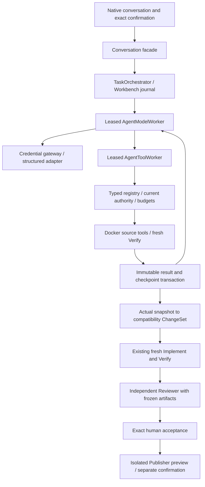

# Agent Runtime v2 implementation

Rollout: `AGENT_RUNTIME_V2_ENABLED=1` only on an isolated instance. Default off.
Existing v1 records and APIs stay readable. SQLite/ArtifactStore/Workbench remain
the sole business authority. Migration 0038 adds insert-time v2 protocol/CAS
invariants without altering historical rows or existing table definitions.

The native user trial reopened and reverified M3 on 2026-10-28: recognizing a package manager
does not establish that its repository's complete approved verification contract
is supported. Package-local Vitest typecheck caches on read-only dependencies
and verification scripts which dynamically install independent tool projects
exposed two separate capabilities. Unsupported forms must stop before coding with `environment_blocked` and
exact command evidence. The derived diagnosis may supersede a historical generic
blocker append-only; original failures, approvals and hashes remain intact.
No model code-repair budget is consumed by this stop. See the
[failure and verification record](acceptance/agent-runtime-v2/user-trial-baseline-failure.json).

A disposable full dependency copy was tested and rejected: `/execution` is
actually `noexec` on the current engine, and copied pnpm launchers failed with
exit 126. That experiment is not shipped. Dependencies remain mounted read-only
with the existing bounded scratch view. The replacement adapter recognizes only
the verified Vitest 2.1.9 typecheck cache. Offline preparation creates a single
data-file link, freezes it in a `node-environment-result-v3` receipt and dependency
inventory, and verification creates its exact hash-derived destination under
`/execution/cache/node`. Code, launchers and the dependency volume stay read-only;
scratch stays noexec. Each fresh verifier gets an empty independent cache. v1/v2
receipts remain supported. Unknown tool versions and cache paths are never
inferred or granted. Nested dynamic tool installers still need a frozen
preparation recipe. Neither opening verification networking, permitting
scratch execution, deleting lint nor changing approved commands is a recovery.



## Durable protocol

`agent_v2_session` points to an immutable TaskSpec artifact: snapshot/base/archive,
PlanVersion, ExecutionAttempt, exact execution authorization, model identities,
runner/policy, actual passing baseline, allowed paths/commands and limits.
`agent_v2_checkpoint` has an expected predecessor hash and state:

```text
ready → model → tools → ready
                  ↓
            paused / blocked / cancelled
model → finished (only with a current actual passing check receipt)
```

A `finished` coding session is not a passed independent review, human acceptance
or completed native journey. The compatibility bridge exports actual captured
files and invokes existing Implement/Verify/Review services. Review repairs
create new immutable attempts and inherit the prior workspace snapshot and
cumulative usage under the same authorization.

Each model call and tool has a persistent Job with one attempt. Call identity,
input/source hashes, started/result events, artifact IDs and checkpoint changes
are recorded. Result + next checkpoint + successor dispatch + Job success share
a transaction. Duplicate dispatch is keyed by checkpoint hash. Model calls and
reads/writes/checks/repairs/time/token/output limits are separately accounted.
Unknown/lost model completions retain the full reservation. Known completions
settle it against actual usage; previous failed calls are never reset.

A worker lost after an unacknowledged tool start cannot blindly repeat tests.
Reconciliation blocks that session with `agent_step_outcome_unknown`. A result
already committed before restart is consumed without another tool invocation.
Pause drains an in-flight step to its checkpoint before stopping dispatch.

Vendor call IDs are namespaced by the persisted model Job ID, because providers
may reuse an ID in a later response. Raw decisions remain separate evidence.
Context is rebuilt from the journal: named receipt index, current changed-file
hashes, current check outcome, required next step and recent decisions. Only two
bounded feedback bodies are inlined; larger bodies retain paged artifact refs.
The complete frozen Plan and Issue are verified and issued as a task-context artifact, with an explicit bounded inline preview. `read_artifact` is restricted to that task's platform-issued context and tool receipts. This fixes measured context/replay failures without increasing limits.
After a successful source receipt the derived next step advances to
`continue_implementation`; it must not instruct endless source reads until a
write has happened. This state error was exposed by a new real-model sample,
ended as failed, fixed and verified with a different frozen sample.

## Sandbox Gateway

Tools: `list_paths`, `search_code`, `read_file`, `apply_patch`, `read_diff`,
`run_approved_checks`, `inspect_failure`, `read_artifact`, `get_task_status`.
The model supplies no command argv: every approved command runs, in its exact
working directory, using the existing credential-free, networkless verifier.

A logical workspace is the original archive plus immutable snapshots of changed
files. Each call reconstructs that same view inside an ephemeral Worker volume,
checks inventory hashes and destroys the physical volume afterward. The source
supervisor runs as fixed trusted Python in the restricted container. It never
imports repository code. Test code runs only through the existing Verify
supervisor. The model/Provider process owns no Docker capability.

One exact patch targets one approved file with its prior SHA-256 and unique
anchor. It writes a temporary file and atomically replaces the target. Repeated
calls may edit that file again. Scope, symlinks, paths, content limits and
inventory are checked. Conflicts return bounded protocol feedback, never fuzzy
edits. Source reads do not widen write authority. Actual sandbox capture, rather
than a model-authored diff, produces the immutable snapshot/export.

Pagination retains total bytes, content hash, current/next offsets and explicit
partial evidence references. Oversized test results are indexed into artifacts;
model context does not treat a prefix as complete evidence. UTF-8 pages preserve characters and reject invalid offsets. Search results include exact file hashes, lines and byte offsets for targeted reads.

## Errors, UI and publication

Typed failures include category, safe reason code, retryability, remaining
budget, next allowed action, blocking scope and evidence reference. The native
UI displays tools, timestamps, budgets and paged artifact receipts. Existing
progress questions remain independent of background model/tool jobs. Neither a
reply nor a natural-language confirmation creates approval.

Facade read arguments use compact disjoint schema shapes for ordinary facts,
issued context references and repository files. Hosted-provider probes rejected
conditional `allOf/if` schemas with HTTP400; the equivalent explicit shapes
returned HTTP200. Irrelevant per-tool fields are omitted to preserve input
budgets. Only missing empty presentation on an explicitly read-only step is
normalized; no action, source identity or final answer is invented. Review
provider failures retain their safe typed category rather than becoming a
generic code-generation error.

The existing Publisher, exact human acceptance, stale checks, outbox and unknown
external-write reconciliation are unchanged. v2 tools cannot call them. CLA,
ready and metadata updates retain their separately confirmed boundaries.

Verification evidence and unpassed native/cross-platform gates are maintained in
[acceptance/agent-runtime-v2](acceptance/agent-runtime-v2/README.md).

## Bounded planning context

New planning requests pin `agent_runtime_version`; only v2 requests use the
48 KB planning target and 96 KB hard input cap. Large repository sources keep
full hash-bound originals as artifacts and a partial index. Literal queries and
line ranges retrieve exact excerpts. Explicitly requested pages remain pinned;
the target can truthfully be exceeded, never the hard cap. The native Python
investigation saved a plan using real source queries/line pages. Historical v1
planning requests retain their prior policy.

Planning output requires a nonempty supported outcome. Actual provider probes
returned an empty object for the old optional schema. Equivalent root `anyOf`
outcomes are supported; `minProperties` caused an upstream HTTP500 and is omitted
because the complete Plan already has required domain fields. Server-side
validation and source identity checks remain authoritative. No supplied answer,
plan or business patch was inserted into a live model run.

Environment prerequisites also use bounded persistent read batches. A measured
native TypeScript investigation needed 35 configuration paths and failed the
single-call limit of 32 with an empty path-error list. That sample was ended.
New v2 plans retain their full draft and read at most 32 prerequisites per job;
remaining paths are recomputed from immutable evidence after each result and
restart. Existing read rounds, model/token/time limits and path authorization
still apply. Invalid/unavailable paths remain rejected. Historical v1 requests
retain their original policy. Exceeding total read limits still stops with a
recorded evidence gap, never silently approving a partially read plan.

## Native trial dialogue recovery

The user trial exposed an HTTP200 final observation rejected solely because an
empty `reads` list was omitted. Runtime v4 may default that list only for an
explicit `respond` with a nonempty answer. Actions, answers, citations, nulls and
tool arguments are never inferred. Raw output and the exact default are retained
in a normalization artifact. Read-step presentation is suppressed before tool
execution; final citations still require actual issued evidence. v2/v3 legacy
turn parsing stays unchanged.

Bare result/progress questions use persisted facts without model calls or
background cancellation. Failed or narration-only planning is displayed as idle
and incomplete. An explicit continue resumes the exact failed read-only planning
payload before chat routing, retaining source/state/plan/model binding, read and
repair rounds and cumulative usage. Source changes, stops and exhausted budgets
block recovery. Old continues that only narrated can be reconciled once using
their original user source; such platform recovery is durably marked maintenance
and never counts as autonomous native delivery.

Background v2 draft jobs require actual source reads, a complete plan or
structured material questions. A standalone promise cannot complete a plan job;
it uses the existing bounded repair mechanism and is recorded as rejected.
Ordinary conversational explanations retain their read-only final-response path.

## UPEVE candidate integration

New opt-in plans may pin the versioned environment graph and consume separate
preparation, entrypoint and baseline evidence before admission. Existing plans
retain their original protocol. See [environment-engine-v1.md](environment-engine-v1.md)
for exact activation, supported semantics, unresolved real regressions and the
separate acceptance gates; this does not close M5/M6.

New DeepSeek v2 plan bindings may freeze `agent-native-tools-v1`: the Provider
registers the nine existing restricted tools plus two terminal Decision functions
in the API. The native decoder accepts only registered names and strict JSON
arguments, with one to four unique calls; it rejects mixed terminal/tool turns,
unknown functions, unverified usage and scope changes. It discards private reasoning.
Only the existing Sandbox tool worker executes validated calls. Terminal requests
do not bypass finish verification or independent Review. The schema/instruction
hash travels through plan binding, preflight, exact confirmation, authorization
and TaskSpec; existing frozen sessions keep their original structured transport.
See [migration](agent-runtime-v2-migration.md#forward-revision-0041-frozen-native-model-functions)
and the [acceptance ledger](acceptance/universal-environment-v1/README.md) for
controlled versus native evidence and unresolved gates.

SQLite workflow advancement takes the same write lock as exact stop before
reading its decision snapshot. A successor that wins that transaction belongs
to the stop's frozen cancellation scope; a stop that wins is observed before
any successor decision. Locking only the later append left a stale coordinator
able to enqueue after stop. The worker independently checks the latest stop
before allocating a workspace. Actual rejected-race evidence and the deterministic
failure-before/fix-after test remain distinct from native Issue delivery evidence.

A native response containing more than four calls rejects its entire batch before
argument parsing or tool execution. A trusted parser exception may use the existing
two protocol corrections only when reported usage is verified within that turn's
reservation. Each correction is a new persistent model Job charged to the same
call/token/time limits; failed reservations remain charged. It never selects the
first four calls, enlarges the limit or uses provider-retry allowance. Other
failures, unverified/excessive usage and exhausted quota still block. A versioned
rejection receipt stores bounded count facts only, with no raw provider data.
Already blocked sessions retain their terminal checkpoint; this behavior cannot
retroactively resume them or fill missing historical response metadata.

New native transport hashes also freeze the prompt projection policy. Registered
API function schemas are referenced instead of duplicated in user input. The
recent eight receipt summaries stay inline; the complete history index, including
all original receipt references and correlation IDs, is a content-addressed
`agent-tool-history-index-v1` artifact bound to session/binding/source. A model
start issues that read-only index through the existing context-artifact mechanism.
Paging uses the same scoped read_artifact tool; arbitrary references still deny.
Nothing is dropped from the journal or full index. Approved inputs, checks, paths,
feedback and the32,000-byte admission cap remain exact. Legacy structured prompts
retain their original wire. Old native contract hashes remain readable but stale
for execution; adoption needs a new child plan and precise approval.

The native projection can promote the complete, hash-verified approved task input
into the prompt when the resulting full native wire is at most32,000 bytes. This
preserves every Plan/Issue field and avoids forcing another paged read when the
complete contract already fits. A mismatched input reference fails closed; an
oversized candidate retains the original honest partial descriptor and scoped
artifact. The strategy and unchanged limit enter the transport digest. Legacy
structured prompts retain their original wire.

Maintenance records without a nonempty string source ID remain
`legacy_unverified`. V1 observation and v2 metrics conservatively count each
such record as operator intervention rather than failing the page or granting
autonomous eligibility. The v2 measurement note discloses the incomplete evidence;
no historical payload or provenance is repaired in place.
