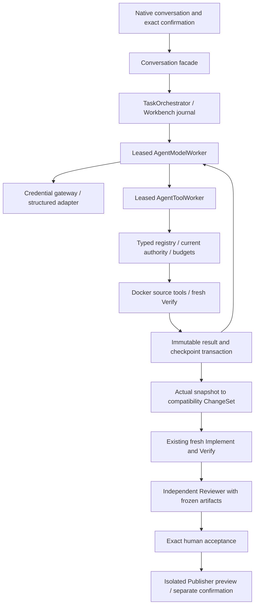

# Agent Runtime v2 implementation

Rollout: `AGENT_RUNTIME_V2_ENABLED=1` only on an isolated instance. Default off.
Existing v1 records and APIs stay readable. SQLite/ArtifactStore/Workbench remain
the sole business authority. Migration 0038 adds insert-time v2 protocol/CAS
invariants without altering historical rows or existing table definitions.



## Durable protocol

`agent_v2_session` points to an immutable TaskSpec artifact: snapshot/base/archive,
PlanVersion, ExecutionAttempt, exact execution authorization, model identities,
runner/policy, actual passing baseline, allowed paths/commands and limits.
`agent_v2_checkpoint` has an expected predecessor hash and state:

```text
ready → model → tools → ready
                  ↓
            paused / blocked / cancelled
model → finished (only with a current actual passing check receipt)
```

A `finished` coding session is not a passed independent review, human acceptance
or completed native journey. The compatibility bridge exports actual captured
files and invokes existing Implement/Verify/Review services. Review repairs
create new immutable attempts and inherit the prior workspace snapshot and
cumulative usage under the same authorization.

Each model call and tool has a persistent Job with one attempt. Call identity,
input/source hashes, started/result events, artifact IDs and checkpoint changes
are recorded. Result + next checkpoint + successor dispatch + Job success share
a transaction. Duplicate dispatch is keyed by checkpoint hash. Model calls and
reads/writes/checks/repairs/time/token/output limits are separately accounted.
Unknown/lost model completions retain the full reservation. Known completions
settle it against actual usage; previous failed calls are never reset.

A worker lost after an unacknowledged tool start cannot blindly repeat tests.
Reconciliation blocks that session with `agent_step_outcome_unknown`. A result
already committed before restart is consumed without another tool invocation.
Pause drains an in-flight step to its checkpoint before stopping dispatch.

Vendor call IDs are namespaced by the persisted model Job ID, because providers
may reuse an ID in a later response. Raw decisions remain separate evidence.
Context is rebuilt from the journal: named receipt index, current changed-file
hashes, current check outcome, required next step and recent decisions. Only two
bounded feedback bodies are inlined; larger bodies retain paged artifact refs.
The complete frozen Plan and Issue are verified and issued as a task-context artifact, with an explicit bounded inline preview. `read_artifact` is restricted to that task's platform-issued context and tool receipts. This fixes measured context/replay failures without increasing limits.
After a successful source receipt the derived next step advances to
`continue_implementation`; it must not instruct endless source reads until a
write has happened. This state error was exposed by a new real-model sample,
ended as failed, fixed and verified with a different frozen sample.

## Sandbox Gateway

Tools: `list_paths`, `search_code`, `read_file`, `apply_patch`, `read_diff`,
`run_approved_checks`, `inspect_failure`, `read_artifact`, `get_task_status`.
The model supplies no command argv: every approved command runs, in its exact
working directory, using the existing credential-free, networkless verifier.

A logical workspace is the original archive plus immutable snapshots of changed
files. Each call reconstructs that same view inside an ephemeral Worker volume,
checks inventory hashes and destroys the physical volume afterward. The source
supervisor runs as fixed trusted Python in the restricted container. It never
imports repository code. Test code runs only through the existing Verify
supervisor. The model/Provider process owns no Docker capability.

One exact patch targets one approved file with its prior SHA-256 and unique
anchor. It writes a temporary file and atomically replaces the target. Repeated
calls may edit that file again. Scope, symlinks, paths, content limits and
inventory are checked. Conflicts return bounded protocol feedback, never fuzzy
edits. Source reads do not widen write authority. Actual sandbox capture, rather
than a model-authored diff, produces the immutable snapshot/export.

Pagination retains total bytes, content hash, current/next offsets and explicit
partial evidence references. Oversized test results are indexed into artifacts;
model context does not treat a prefix as complete evidence. UTF-8 pages preserve characters and reject invalid offsets. Search results include exact file hashes, lines and byte offsets for targeted reads.

## Errors, UI and publication

Typed failures include category, safe reason code, retryability, remaining
budget, next allowed action, blocking scope and evidence reference. The native
UI displays tools, timestamps, budgets and paged artifact receipts. Existing
progress questions remain independent of background model/tool jobs. Neither a
reply nor a natural-language confirmation creates approval.

Facade read arguments use compact disjoint schema shapes for ordinary facts,
issued context references and repository files. Hosted-provider probes rejected
conditional `allOf/if` schemas with HTTP400; the equivalent explicit shapes
returned HTTP200. Irrelevant per-tool fields are omitted to preserve input
budgets. Only missing empty presentation on an explicitly read-only step is
normalized; no action, source identity or final answer is invented. Review
provider failures retain their safe typed category rather than becoming a
generic code-generation error.

The existing Publisher, exact human acceptance, stale checks, outbox and unknown
external-write reconciliation are unchanged. v2 tools cannot call them. CLA,
ready and metadata updates retain their separately confirmed boundaries.

Verification evidence and unpassed native/cross-platform gates are maintained in
[acceptance/agent-runtime-v2](acceptance/agent-runtime-v2/README.md).

## Bounded planning context

New planning requests pin `agent_runtime_version`; only v2 requests use the
48 KB planning target and 96 KB hard input cap. Large repository sources keep
full hash-bound originals as artifacts and a partial index. Literal queries and
line ranges retrieve exact excerpts. Explicitly requested pages remain pinned;
the target can truthfully be exceeded, never the hard cap. The native Python
investigation saved a plan using real source queries/line pages. Historical v1
planning requests retain their prior policy.

Planning output requires a nonempty supported outcome. Actual provider probes
returned an empty object for the old optional schema. Equivalent root `anyOf`
outcomes are supported; `minProperties` caused an upstream HTTP500 and is omitted
because the complete Plan already has required domain fields. Server-side
validation and source identity checks remain authoritative. No supplied answer,
plan or business patch was inserted into a live model run.

Environment prerequisites also use bounded persistent read batches. A measured
native TypeScript investigation needed 35 configuration paths and failed the
single-call limit of 32 with an empty path-error list. That sample was ended.
New v2 plans retain their full draft and read at most 32 prerequisites per job;
remaining paths are recomputed from immutable evidence after each result and
restart. Existing read rounds, model/token/time limits and path authorization
still apply. Invalid/unavailable paths remain rejected. Historical v1 requests
retain their original policy. Exceeding total read limits still stops with a
recorded evidence gap, never silently approving a partially read plan.
