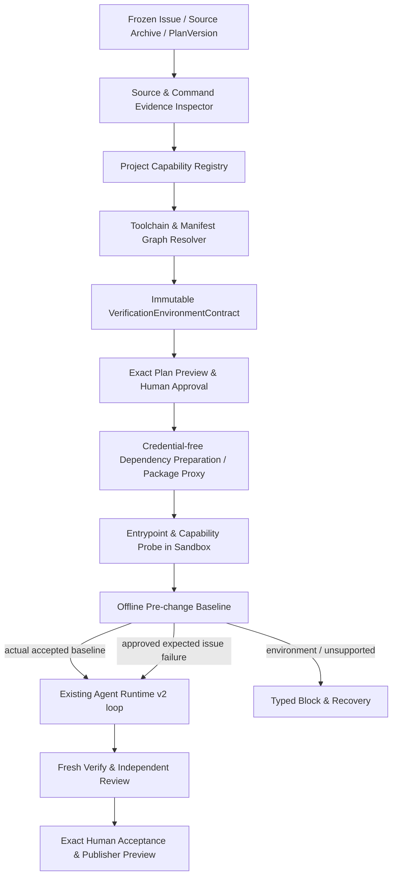

# UPEVE v1 — 架构、接口与数据契约

> 本文件是落地设计基线；代码实现须与现有 Workbench、Sandbox、Provider、Publisher 边界一致。示例字段为推荐契约而非已存在 API。

## 1. 系统结构



工程原则：**静态识别不等于可执行；准备成功不等于验证通过；模型建议不等于事实；Job succeeded 不等于测试成功。**

### 1.1 建议模块（实际按现有布局落点）

| 职责 | 建议组件 | 允许的输入 / 禁止的行为 |
| --- | --- | --- |
| 发现 | `ProjectEvidenceInspector` | 只读取已签名/散列的归档内容；禁止 eval Makefile/CI/项目脚本 |
| 命令解释 | `VerificationCommandResolver` | 精确 argv、cwd、批准命令和脚本递归图；不改变已批准 argv |
| 依赖图 | `EnvironmentManifestResolver` 插件协议 | 静态 requirements、Python metadata、package/workspaces/lockfile；不执行任意安装脚本 |
| 能力注册 | `CapabilityRegistry` | language/ecosystem/manager/tool/version/platform 组合与明确支持条件；不能含仓库名 |
| 冻结与准备 | `ToolchainPreparationService` | hash-bound recipe、package proxy、isolated builder；不得持有 GitHub 写凭据 |
| 工具可用性 | `ToolchainProbe` | 当前受限环境实际核实所需入口与依赖；不把 `--help` 或零测试冒充验证成功 |
| 实际基线 | `BaselineVerifier` | 容器、原授权全命令、真实执行语义；无网络、无凭据 |
| 编码准入 | `AgentRuntimeV2Admission` | 当前同源/同平台/同审批收据；保留未知阻塞 |

解析器使用**版本化插件注册**，例如 `PythonPipRequirementsV1`、`PythonPep621V1`、`NodePnpmWorkspaceV1`、`NodeScriptChainV1`、`VitestDataCacheV1`。插件是语言、规范与工具版本支持，不是仓库项目特判。未知语义必须产生“无法安全证明”的明确缺口；不通过模糊匹配猜测下一步。

## 2. 建议的契约与类型（可独立测试）

### 2.1 `VerificationEnvironmentContract` v1

```json
{
  "version": "verification-environment-contract-v1",
  "binding": {
    "task_id": "<immutable id>",
    "snapshot_hash": "<sha256>",
    "source_archive_hash": "<sha256>",
    "base_commit_sha": "<git sha>",
    "plan_version_hash": "<sha256>",
    "approved_commands_hash": "<sha256>",
    "target_platform": "linux/arm64",
    "runner_image_digest": "sha256:<64 hex>",
    "sandbox_policy_hash": "<sha256>"
  },
  "resolver_versions": {
    "command": "command-graph-v1",
    "python": "python-requirements-v1",
    "node": "node-toolchain-v1"
  },
  "commands": [
    {
      "command_id": "lint_check",
      "argv": ["ruff", "check", "src", "tests"],
      "working_directory": ".",
      "source_refs": ["Makefile@sha256:<hash>"],
      "required_executable": "ruff",
      "toolchain_refs": ["tool:ruff"],
      "resolution": "resolved"
    }
  ],
  "toolchains": [
    {
      "id": "tool:ruff",
      "ecosystem": "python",
      "declaration_refs": ["requirements/testing.txt@sha256:<hash>"],
      "version_constraint": "<declared version or unresolved>",
      "platform": "linux/arm64",
      "lock_evidence": "<verified lock/record or null>",
      "status": "resolvable"
    }
  ],
  "unresolved": [],
  "admission": "static_admitted",
  "contract_hash": "<canonical sha256>"
}
```

**不能把示例中 `<...>` 占位符写入正式校验数据**。正式代码使用与既有业务模型一致的严格 Pydantic/dataclass、JSON schema 和 `canonical_json` 哈希，关联真实 PlanVersion、Attempt、Policy。以真实冻结数据中的工具链版本、平台/ABI、包源、锁文件和脚本完整依赖图决定是否可重用准备工件。

### 2.2 `ToolchainPreparationReceipt` v1

建议包含：`contract_hash`、`dependency_plan_hash`、`toolchain_graph_hash`、`target_os_arch_abi`、`prepared_image_digest`、`package_proxy_policy_hash`、`resolved_version_set_hash`、`wheels_or_package_integrity_hashes`、`mutable_data_cache_adapter_refs`、`executables[]`（命令名、实际绝对路径/容器内路径、版本/包关联、运行/链接诊断）、`missing[]`、`status`、`created_at`。状态必须分开 `prepared`、`partial`、`unsupported`、`failed`。

- `prepared` 表示下载、安装和受控入口核实成功，不等于测试通过。
- 未在当前容器真实核实的可执行入口不能标记 `available`。
- 若版本与许可未能安全固定，则标记 `unresolved`；不能因系统 PATH 碰巧有工具就假定精确可复现。
- receipt 与目标平台必须精确绑定，arm64 不等于 amd64。

### 2.3 `BaselineVerdict` v1

最少包含：`contract_hash`、`preparation_receipt_hash`、`source_snapshot_hash`、`command_results[]`、`required_command_count`、`executed_command_count`、`test_discovery_count/evidence`（仅有证据时）、`outcome`、`reason_codes`、`baseline_artifact_hash`、`policy/image_hashes`。

`outcome`：

- `passed`
- `expected_issue_reproduction`（须关联具体经过批准的可失败检查及其他必需通过项）
- `preexisting_failure`
- `environment_blocked`
- `unsupported`
- `unknown`

建议 `reason_codes` 至少区分：

`command_not_found`, `entrypoint_missing`, `dependency_unresolved`, `dependency_version_conflict`, `recursive_include_cycle`, `requirements_unsafe_directive`, `unsupported_dynamic_installer`, `platform_binary_unavailable`, `native_service_required`, `immutable_cache_write_blocked`, `network_required_in_verify`, `baseline_actual_assertion_failure`, `baseline_help_only`, `baseline_zero_tests`, `baseline_evidence_insufficient`, `provider_gateway_unavailable`（Provider 错误不等于环境错误）。

## 3. 通用静态解析算法

### 3.1 Python

1. 基于**已批准命令**与项目线索定位可能提供其入口的声明文件；`Makefile` / CI 是命令和依赖关系**证据**，不是可执行脚本。
2. `pyproject.toml`：解析直接依赖、`[dependency-groups]` 的已支持子集、`[project.optional-dependencies]` 可证明会使用的 extras、PEP 517 构建约束；动态字段要求有既有可信 wheel metadata 策略或明确阻断。
3. `requirements` parser：逐行进行**有限语法解析**，支持普通合法 PEP 508 包声明、`-r path`/`--requirement path`、`-c path`/`--constraint path`；相对父文件解析；检测循环、重名歧义、同仓范围和哈希，保留声明 provenance；按现有包代理策略拒绝或隔离不受支持的 URL/index/VCS/hash 模式。
4. `-c` 只施加版本约束，**不能**当作需要安装的新依赖。`-r` 可以引入包。解析器不能把 `-r` 当作普通 `python_requirement_error` 丢弃后声称已准备完整。
5. 从命令入口 `ruff`、`stubtest` 等反向建立“提供入口的**发行包**”映射。`stubtest` 并非一定存在名为 `stubtest` 的 PyPI 包；应结合声明与安装后 `entry_points` 实际核实，而不是靠命令名猜测包名。
6. 对尚未支持的 `tox`、Poetry、uv、PDM、Makefile 高级表达式，输出明确未支持条件；将来的生态插件对其提供版本化验证。

**限制建议（可以写配置并测试，而不是硬编码不可见魔法值）**：最大 include 深度 8，总引用文件 64，累计文本 2 MiB，最多 500 条依赖声明；超限为 `unsupported`/`resource_limit`, 不能静默忽略后续依赖。限制必须结合原项目现有上限与安全策略实现，不得自行突破资源预算。

### 3.2 Node/TypeScript

1. 解析 `package.json` scripts、workspace 关系、packageManager/lockfile/平台引擎，构建脚本的**有向引用图**。
2. 支持可证明的受限脚本包装方式（如 `pnpm run lint`、`node scripts/run.js lint` 中已被解析器识别的固定目录映射）。需要 AST/严格语法匹配时，仅解析，不执行；对任意动态 JS 分支返回 `unsupported_dynamic_installer`。
3. 子脚本引用独立工具目录时，读取该工具 `package.json` 的 dependencies 和可验证的 lockfile 关系，单独准备、冻结，并将工具入口加入受限执行环境。
4. 版本化缓存写入适配由工具身份、版本、路径语义、hash 完整决定；不能按仓库名或“错误里出现 EROFS”自动宽放写权限。未知缓存行为必须阻断。
5. 不允许在离线 Verify 阶段静默执行 `npm/pnpm/yarn/bun install`。当脚本本身强制动态安装、无法证明能通过预装使其不触发时，返回有依据的不支持，而不是套项目特判。

### 3.3 编译原生命令 / 可信边界

- 静态解析是**安全子集**，不是万能的 shell/JS/Python 求值器。`Makefile` 里的 `$(shell ...)`、CI 的下载脚本、脚本中 `eval`、运行期动态网络插件都不能作为安全静态依赖。
- 构建原生轮包或 npm 生命周期脚本涉及执行不可信代码，必须继续使用现有单独准备容器及资源/代理/凭据隔离；不得在 API/Provider 宿主执行。
- 处理符号链接、重定向、子模块、路径大小写、空目录、平台可执行位、包源转向、恶意脚本、许可证限制和下载校验失败。

## 4. 能力状态机与业务衔接

```text
source_readable
    → static_inspected
    → command_graph_resolved
    → plan_previewed_and_exactly_approved
    → preparation_queued
    → toolchain_prepared
    → entrypoints_probed
    → baseline_verified
    → agent_v2_admitted
    → code_and_review
```

在每一阶段允许明确状态 `unsupported`、`environment_blocked`、`stale`、`cancelled`，均需 evidence/ref 和稳定 reason_code。

- 不能仅凭 `inspect_environment(...): status=supported` 填充 `verification_supported=proven`；`proven` 必须绑定当前完整 baseline 的真实证据。
- 不改变现有精确批准流程。如果用户确认前发现静态不可支持，应阻止错误的“可以执行”承诺；确认后才允许现有权限模型下受限依赖准备及完整基线。必要的方案调整采用 immutable child PlanVersion + 新授权。
- 原 `freeze_spec()` 可在验证迁移后扩充 `environment_contract_hash`；老 TaskSpec 不补伪造字段，不把未通过的旧 baseline 解释成 passed。
- **预期失败例外**：只有明确声明并经用户批准的 Issue 复现命令可标 `expected_issue_reproduction`；计划内其他必需检查仍必须执行并符合约束，否则阻断。
- 基线失败后可自动产生**只读诊断及通用环境重试建议**；执行环境/权限/检查契约发生变化则需重新冻结、重新授权；不得重用原 Approval 冒险执行。

## 5. 工件与可信回放

采用现有 `Workbench` + append-only Event + `ArtifactStore`，无新权威数据库。任何新持久字段按现有 migration 流程升级/回滚。推荐事件：

- `environment_command_graph_resolved`
- `environment_contract_frozen`
- `environment_preparation_receipt`
- `environment_entrypoint_probe`
- `environment_baseline_verdict`
- `environment_capability_blocked`
- `environment_recipe_revised`

事件名仅为建议，落地前检查现有命名与唯一性约束，避免重复体系。重试/恢复必须绑定原 `attempt_id`、`contract_hash`、`authorization_hash`、target image+policy，未知 in-flight outcome 不重复执行副作用，历史记录永远不覆盖。

## 6. 扩展架构

新增适配器应具备：`discover(frozen_inventory) -> Evidence`、`resolve(evidence, approved_commands, target) -> Graph | Unsupported`、`prepare_recipe(graph) -> SignedRecipe`、`probe(receipt, sandbox) -> Capability`，支持 parser_version / recipe_version / supported_platforms / limits。核心调度只依赖接口与 verdict，不依赖具体项目名称。

每项新适配器必须：单元测试 + 恶意 fixture + 真实 OCI 准备 + 不同结构项目的泛化回归 + 各平台证据分类。可以单独安装语言适配器，不能让插件在宿主读取 Secrets、使用 Docker socket 或任意 shell；插件要通过 Sandbox Worker 已有受限入口。

## 7. 性能、输入预算与可诊断性

- 只读并解析和批准命令相关的图节点；大文件保留 hash-bound paged refs，避免模型反复读取整个 CI/锁文件。
- 对重复声明去重**但保留来源**；对冲突展示多个证据而非猜测。
- 依赖下载按内容与目标平台缓存；必须检验版本/平台/文件散列，不得凭文件夹名复用旧准备结果。
- 为用户显示“发现/解析/冻结/准备/入口核验/基线/编码/Review”独立阶段与错误码。Provider HTTP429/502、模型 schema 错误、测试断言、环境不就绪应分别展示。

## 8. 兼容性检查清单

`app/execution_preflight.py`、`app/verification_commands.py`、`app/sandbox_worker/workspace_jobs.py`、`app/sandbox_worker/workspace_dependencies.py`、`app/sandbox_worker/node_dependencies.py`、`app/node_environments.py`、`app/sandbox_worker/verification.py`、`app/contribution_workflow.py`、`app/agent_v2/{orchestrator,capabilities,loop}.py`、对话 API/UI 以及既有 Publish/Review contracts。保留旧版本解析器和历史收据兼容；新增 v1 contract 只对新冻结作业激活，迁移要有 hash/授权一致性证明。
